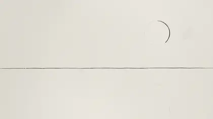
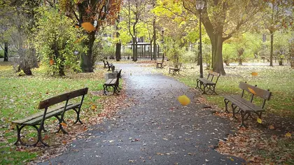
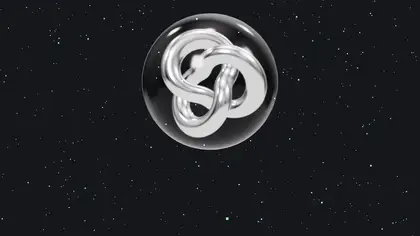
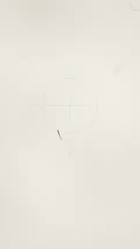
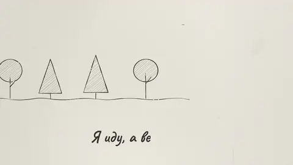
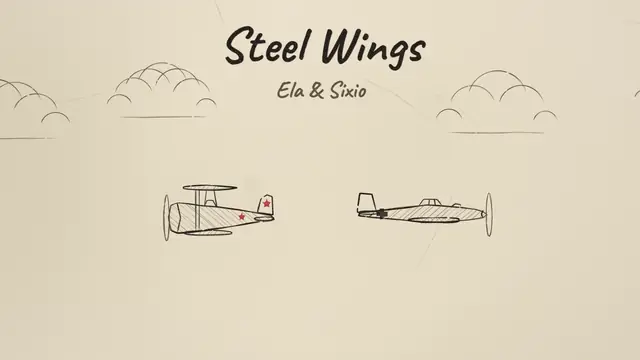

# code-cartoon

English · [Русский](README.ru.md)

A Claude Code skill that makes animated videos out of code. You describe a story; Claude asks a few
questions, writes a storyboard, draws every frame as a function of time in an HTML canvas (or
Three.js for 3D), renders an MP4 with [HyperFrames](https://github.com/heygen-com/hyperframes) and
synthesizes the soundtrack from the same timing. Nothing is generated by a video model: the pencil
lines, the hatching, the paper and the music are all code, and everything runs on your machine.

Made for [6io.io](https://6io.io).

<table>
<tr>
<td width="50%"><br><b>Two worlds</b>: a pencil sketch dives into a Russian lubok print (iris, ornament frame, folk music)</td>
<td width="50%"><br><b>Photo + 3D</b>: a real photo, a crayon drawing that pops up like a book, a dive into space, a narrator</td>
</tr>
<tr>
<td><br><b>Glass and chrome</b>: particles snap into a ring around a chrome knot</td>
<td><br><b>Pencil reel</b> (9:16): a sketch becomes light</td>
</tr>
<tr>
<td colspan="2"><br><b>Clip to a song</b> (new in 1.1): the verse is a pencil landscape drawn bar by bar, the chorus a neon sun that grows with every repeat, the lyrics written as they are sung; a 9:16 cut of the chorus comes from the same project</td>
</tr>
</table>

These five are bundled: `cartoon example <name>` rebuilds any of them (the clip sings a synthesized demo
song), and the renders are attached to the [releases](https://github.com/famfamfam/code-cartoon/releases).

A real clip made with the skill: **Steel Wings**, a WWII dogfight in coloured-pencil 3D to an instrumental
by Ela & Sixio, 2:37, made from the track alone. Click the preview for the full clip (MP4, 82 MB, with the music).

<a href="https://github.com/famfamfam/code-cartoon/releases/download/v1.2.0/Steel-Wings-Ela-Sixio.mp4"></a>

## What it can make

| Style | Palette / template | Looks like |
|---|---|---|
| Pencil, neon, mystic | `graphite`, `neon`, `mystic` | a sketch drawn on twos with boiling lines and hatching |
| Chalk, blueprint, notebook, kraft, ink | `chalk`, `blueprint`, `notebook`, `kraft`, `ink` | the medium's paper, line and hatching rules |
| A child's crayon drawing | `crayon` | wax scribbles, white halos, marker outlines |
| Lubok / Bilibin print | `lubok` | flat colour, bold contours, wave curls, ornament frames, ribbons |
| Retro halftone, newspaper collage | `retro`, `collage` | print dots, misregistration, torn paper |
| Glass and chrome 3D | `--template 3d` | Three.js materials, particles, logos |
| Coloured-pencil 3D | `engine/pencil3d.js`, `sky`, `storm`, `dusk` | planes, cars and cumulus clouds in real 3D, drawn in coloured pencil with boiling outlines; a flight simulation for chases and dogfights |
| Photo + 3D | `--template photo3d` | your photo with a living camera, a picture that pops up, a 3D world |
| Rotoscope hybrid | any | a filmed or generated clip redrawn in the chosen style |
| Clip to a song | `--template clip` | the parts of your song (Suno, Udio, your own, instrumentals too) as worlds, the lyrics written as they are sung, a cut for Reels |

One storyboard, any format: 9:16, 16:9, 1:1, 4:5. Sixteen palettes; the same video recolours with one
line. Preview of all palettes: [`skills/code-cartoon/assets/themes.jpg`](skills/code-cartoon/assets/themes.jpg).

## How it works

1. **Questions first.** Story, style, format, length, text and its language, sound. Every batch of
   questions has a "stop asking, decide yourself" option.
2. **Storyboard.** A table `time | drawn | camera | sound` with one twist at 35–45 % of the length and a
   poster in the last three seconds.
3. **Code.** `cues.js` holds every event time. The scene reads it (`d.cue("twist")`), and so does the
   sound synthesizer, so picture and sound cannot drift apart.
4. **Self-check.** Claude takes snapshots, looks at a contact sheet and zoomed crops, and runs a jump
   and twitch detector before showing you anything.
5. **Render and hand-over.** MP4 at 24 fps, −15 LUFS, a light copy for messengers, and an honest note
   about what was not checked.

## Requirements

- [Claude Code](https://code.claude.com)
- Node.js 22+ and FFmpeg
- Python 3.9+ with `numpy`, `scipy`, `pillow`
- HyperFrames downloads a headless Chrome the first time it renders (about 150 MB).
- Optional, for narration: `pip install piper-tts`. Without it, the system voice of Windows, macOS or
  Linux (`espeak-ng`) works.
- On Windows, use Git Bash. Claude Code's Bash tool already runs it.

Check everything with `skills/code-cartoon/scripts/cartoon doctor`.

## Install

As a plugin from this repository's marketplace:
```bash
claude plugin marketplace add famfamfam/code-cartoon
claude plugin install code-cartoon@famfamfam
```
In a session, `/plugin marketplace add famfamfam/code-cartoon` and `/plugin install code-cartoon@famfamfam`
do the same. The skill is then `/code-cartoon:code-cartoon`, and it also starts by itself when you ask
for a cartoon.

Or copy only the skill (it becomes `/code-cartoon`):
```bash
git clone https://github.com/famfamfam/code-cartoon
cp -R code-cartoon/skills/code-cartoon ~/.claude/skills/
```

## Quick start

Just ask, in any language:

```text
Make a 10-second 9:16 reel in pencil: a seed grows into a tree, the caption "Grow every day" at the end.
```
```text
/code-cartoon сказка на 40 секунд по рисунку сына, в стиле лубка, с голосом рассказчика
```
```text
A 16:9 intro for our podcast, glass and chrome, cut to this song: audio/theme.mp3
```
```text
Make a clip to my Suno song: song.mp3, the lyrics with tags and the vocal stem are next to it. Full clip in 16:9 and the chorus for Reels.
```

The working files of every video are an ordinary folder: `index.html`, `scene.js`, `cues.js`,
`project.md` (story and storyboard), `audio/mix.wav` and the MP4.

## The `cartoon` command

Every step goes through one script: it finds a real Python on every OS, pins the HyperFrames version
and keeps the console in UTF-8. You rarely type it yourself; Claude does.

| Command | What it does |
|---|---|
| `cartoon new <dir> --format 9:16 --duration 12 --palette neon --template 2d\|3d\|photo3d` | a new project; the starter scene works in every format |
| `cartoon new <dir> --template clip --song s.mp3 --lyrics l.txt --vocals v.wav` | a clip to a song: the parts of the song and the lyric lines laid out, a map of the song and a karaoke preview |
| `cartoon song --lrc audio/song.lrc` | re-time the lyrics from an edited LRC (or `--auto`) |
| `cartoon cut reel --auto --format 9:16` | a cut of the clip (the chorus for Reels) as its own project |
| `cartoon example [name] [dir]` | list or build a bundled example |
| `cartoon lint` / `snapshot --at 0,3.9` / `render --output out.mp4` | HyperFrames, pinned to a tested version |
| `cartoon audio` | effects + music mood + narration + your tracks -> `audio/mix.wav` |
| `cartoon voice --fit` | speak the narration cues; caption lengths follow the speech |
| `cartoon beats song.mp3 --snap cues.js` | tempo, beats, bars, energy; put events on the beat |
| `cartoon check out.mp4 --duration 10 --fps 24 --size 1080x1920` | length, fps, size, loudness, true peak, first and last frame |
| `cartoon frames out.mp4 --zoom` / `--twitch` / `--jumps` | look closer: crops, twitching details, unplanned jumps |
| `cartoon sheet out.mp4` / `cartoon share out.mp4 --gif` | contact sheet; light MP4 and GIF/WebP |
| `cartoon analyze ref.mp4` / `cartoon roto clip.mp4 .` | learn from reference videos; rotoscope hybrid |
| `cartoon doctor` / `cartoon selfcheck` | check the machine; check the skill |

## Sound

- 17 synthesized effects (pencil, hatching, eraser, pop, whoosh, chime, page turn, rocket rumble,
  magic shimmer, wind and more), each placed on its cue.
- Music moods: `musicbox`, `folk` (plucked strings over a drone), `space`. The mood turns warm at the twist.
- Narration with [Piper](https://github.com/OHF-Voice/piper1-gpl) (Russian and English voices, local),
  the system voice, or your own recordings. Music ducks under the voice.
- Your own song: `cartoon beats` finds the beat and the drop and moves events onto the grid.
- A clip to a song: `cartoon song` finds the parts of the song (from the tags of the lyrics, the music
  and the voice), times every lyric line (from the vocal stem, an LRC file or the bars) and makes a
  karaoke preview to check the timing before rendering. The picture is locked to the beat.
- The mix is normalised to −15 LUFS with a −1 dBFS true-peak ceiling.

## Limits

- No photorealism and no live facial animation. A real person appears as a real photo
  (photo + 3D template), never as a fake 3D model of them.
- 3D made by code means particles, geometry, materials, toy-like objects and pencil-drawn vehicles
  and clouds, not feature animation.
- Live motion comes through the rotoscope hybrid: a clip you filmed or generated elsewhere, redrawn in style.
- Render time on a laptop: about 40 s for 8 s of 2D at 1080p, about 3.5 min for 40 s of photo + 3D,
  11–16 min for a 2.5-minute clip with pencil 3D. Long clips are shown in stages (keyframes, a draft of
  each part, then the full render).
  Long videos are built from 10–30 s scenes.
- The renderer is HyperFrames 0.8.164; other versions may need small changes.

## Privacy

Everything runs locally: drawing, rendering, sound and narration. The skill sends nothing anywhere and
has no telemetry. Network access is needed only to install dependencies, the headless Chrome and Piper
voices. The skill treats photos of people, especially children, as private and does not publish them.
See [docs/PRIVACY.md](docs/PRIVACY.md).

## Status

Version 1.2.1. Tested on Windows 11 (Git Bash) with Node 24, Python 3.14 and HyperFrames 0.8.164;
CI checks the scripts and renders the templates on Ubuntu and checks the scripts on Windows. The song
analysis is tested on a synthesized song with known answers and was used on a real 2.5-minute
instrumental (a dogfight clip in pencil 3D); tell us how it does on yours.
Planned: automatic object detection on a drawing photo, one project rendered to all formats at once.

## Contributing

See [CONTRIBUTING.md](CONTRIBUTING.md): how to add a palette, a style, a sound or a pitfall, and how to
run the checks.

## License

MIT, see [LICENSE](LICENSE). Bundled third-party files (three.js, GSAP, fonts, a sample photo) keep
their own licences, listed in [THIRD_PARTY_NOTICES.md](THIRD_PARTY_NOTICES.md).

Author: [famfamfam](https://github.com/famfamfam).
